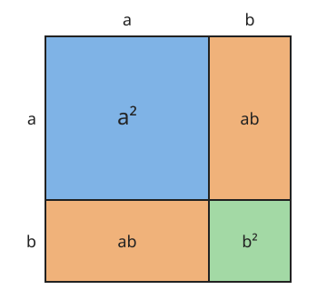

# Výrazy

**Co se naučíte**
- co je proměnná a výraz a jak výraz správně zapsat,
- vypočítat hodnotu výrazu a určit, kdy výraz nemá smysl,
- sčítat, odčítat a násobit výrazy a odstraňovat závorky,
- vytýkat společného činitele před závorku,
- používat vzorce $(a \pm b)^2$ a $a^2 - b^2$.

**Co potřebujete znát**
- [počítání se zápornými čísly](../../zaklady/01-cisla/vyklad.md#sčítání-a-odčítání-celých-čísel) a [pořadí operací](../../zaklady/03-mocniny/vyklad.md#mocniny-v-pořadí-operací),
- [pravidla pro počítání s mocninami](../../zaklady/03-mocniny/vyklad.md#pravidla-pro-počítání-s-mocninami),
- [počítání se zlomky](../../zaklady/02-zlomky/vyklad.md) a [odmocninami](../../zaklady/04-odmocniny/vyklad.md),
- [zápis množiny](../../teorie-mnozin/01-mnozina-a-jeji-zapis/vyklad.md) a [reálná čísla](../../zaklady/04-odmocniny/vyklad.md#iracionální-čísla-a-číselné-obory).

## Proměnná a výraz

Obvod čtverce o straně $3\ \mathrm{cm}$ je $4 \cdot 3 = 12\ \mathrm{cm}$, o straně $5\ \mathrm{cm}$ je $4 \cdot 5 = 20\ \mathrm{cm}$. Výpočet je pokaždé stejný, mění se jen délka strany. Obecně ho zapíšeme tak, že délku strany označíme písmenem, například $a$:

$$o = 4 \cdot a$$

Písmeno, za které můžeme dosadit různá čísla, se nazývá **proměnná**. Zápis složený z čísel, proměnných, znamének operací a závorek, který dává smysl, je **výraz**. Výraz bez proměnných, například $2 + 3 \cdot 4$, je **číselný výraz**.

Pro zápis výrazů platí domluvy:
- Znak násobení mezi číslem a proměnnou nebo mezi proměnnými se vynechává: $4 \cdot a = 4a$, $\ x \cdot y = xy$.
- Číslo se píše před proměnné: $a \cdot 3 = 3a$, ne $a3$.
- Jednička před proměnnou se nepíše: $1x = x$, $\ -1x = -x$.
- Opakované násobení se zapisuje mocninou: $x \cdot x \cdot x = x^3$.

**Příklad.** Zapište výrazem: „trojnásobek čísla $x$ zmenšený o 5“ a „druhá mocnina součtu čísel $a$ a $b$“.

$$3x - 5 \qquad (a + b)^2$$

> ⚠️ Pozor: „druhá mocnina součtu“ $(a + b)^2$ a „součet druhých mocnin“ $a^2 + b^2$ jsou různé výrazy. Rozhoduje, co se počítá jako poslední.

## Hodnota výrazu

Když za proměnné dosadíte čísla a výraz vypočítáte, dostanete **hodnotu výrazu**. Počítejte ve správném [pořadí operací](../../zaklady/03-mocniny/vyklad.md#mocniny-v-pořadí-operací).

**Příklad.** Vypočítejte hodnotu výrazu $2x^2 - 3x + 1$ pro $x = 4$ a pro $x = -2$.

$$x = 4: \quad 2 \cdot 4^2 - 3 \cdot 4 + 1 = 2 \cdot 16 - 12 + 1 = 21$$

$$x = -2: \quad 2 \cdot (-2)^2 - 3 \cdot (-2) + 1 = 2 \cdot 4 + 6 + 1 = 15$$

> ⚠️ Pozor: Záporné číslo dosazujte vždy do závorky. Pro $x = -2$ je $x^2 = (-2)^2 = 4$, ne $-2^2 = -4$ (viz [mocniny záporných čísel](../../zaklady/03-mocniny/vyklad.md#mocniny-záporných-čísel-a-zlomků)).

## Kdy výraz nemá smysl

Některá čísla do výrazu dosadit nelze, protože by vznikla nepovolená operace:

- **dělení nulou**: jmenovatel zlomku nesmí být nula,
- **sudá odmocnina ze záporného čísla**: pod druhou odmocninou nesmí být záporné číslo.

Čísla, pro která výraz smysl má, se zapisují **podmínkami**. Často se k nim připojuje, z jaké množiny proměnná je (zpravidla $x \in \mathbb{R}$).

**Příklad.** Určete, kdy mají smysl výrazy $\dfrac{5}{x - 3}$ a $\sqrt{x + 2}$.

- $\dfrac{5}{x - 3}$: jmenovatel $x - 3 \ne 0$, tedy $x \ne 3$.
- $\sqrt{x + 2}$: musí platit $x + 2 \ge 0$, tedy $x \ge -2$.

Podmínky je dobré psát ihned na začátku výpočtu. Budou se vám hodit v dalších kapitolách algebry u lomených výrazů a rovnic.

## Jednočleny a mnohočleny

Výraz, který je jen součinem čísla a mocnin proměnných, je **jednočlen**: $5x$, $\ -3a^2b$, $\ \frac{1}{2}y^3$, $\ 7$. Číslo před proměnnými je **koeficient** (v $-3a^2b$ je to $-3$).

Součet jednočlenů je **mnohočlen**. Jednotlivé jednočleny jsou jeho **členy**:

$$4x^2 - 3x + 7 \quad \text{má členy} \quad 4x^2,\ -3x,\ 7$$

Znaménko před členem k němu patří. Člen bez proměnné (zde $7$) je **absolutní člen**.

**Podobné členy** se liší nanejvýš koeficientem, proměnné a jejich exponenty mají stejné: $3x^2$ a $-5x^2$ jsou podobné, $3x^2$ a $3x$ nejsou.

## Sčítání a odčítání výrazů

Sčítat a odčítat lze jen podobné členy. Sečtou se jejich koeficienty a proměnná část se opíše, podobně jako u [stejných odmocnin](../../zaklady/04-odmocniny/vyklad.md#pravidla-pro-počítání-s-odmocninami):

$$3x^2 + 5x^2 = 8x^2 \qquad 4ab - 7ab = -3ab$$

Této úpravě se říká **sčítání podobných členů**. Nepodobné členy zůstanou vedle sebe: $3x^2 + 5x$ už zjednodušit nelze.

**Odstranění závorek:**
- Je-li před závorkou **plus**, závorku jen vynecháte: $a + (b - c) = a + b - c$.
- Je-li před závorkou **minus**, změníte znaménka všech členů v závorce: $a - (b - c) = a - b + c$.

Minus před závorkou totiž znamená [přičíst opačné číslo](../../zaklady/01-cisla/vyklad.md#sčítání-a-odčítání-celých-čísel) celé závorky.

**Příklad.** Zjednodušte $(5x^2 - 3x + 2) - (2x^2 - 4x - 1)$.

$$
\begin{aligned}
(5x^2 - 3x + 2) - (2x^2 - 4x - 1) &= 5x^2 - 3x + 2 - 2x^2 + 4x + 1 && \text{odstranění závorek} \\
&= 3x^2 + x + 3 && \text{sčítání podobných členů}
\end{aligned}
$$

> ⚠️ Pozor: Minus před závorkou mění znaménko **všech** členů, i posledního. Častá chyba je $-(2x^2 - 4x - 1) = -2x^2 + 4x - 1$. Správně je $+1$ na konci.

## Násobení výrazů

**Jednočlen krát jednočlen:** vynásobte koeficienty a proměnné podle [pravidel pro mocniny](../../zaklady/03-mocniny/vyklad.md#pravidla-pro-počítání-s-mocninami):

$$3x^2 \cdot (-4x^3) = -12x^5 \qquad 2ab \cdot 5a = 10a^2b$$

**Jednočlen krát mnohočlen:** jednočlenem vynásobte **každý** člen v závorce. Úprava se jmenuje **roznásobení**:

$$a(b + c) = ab + ac$$

**Příklad.** $-2x(3x - 5) = -2x \cdot 3x + (-2x) \cdot (-5) = -6x^2 + 10x$

**Mnohočlen krát mnohočlen:** každým členem první závorky vynásobte každý člen druhé závorky:

$$(a + b)(c + d) = ac + ad + bc + bd$$

**Příklad.** Roznásobte $(x + 3)(2x - 5)$.

$$
\begin{aligned}
(x + 3)(2x - 5) &= x \cdot 2x + x \cdot (-5) + 3 \cdot 2x + 3 \cdot (-5) \\
&= 2x^2 - 5x + 6x - 15 \\
&= 2x^2 + x - 15
\end{aligned}
$$

Kontrola dosazením: pro $x = 1$ je $(1 + 3)(2 - 5) = -12$ a také $2 + 1 - 15 = -12$. ✓

> ⚠️ Pozor: Dosazení libovolného čísla je rychlá kontrola každé úpravy. Upravený výraz musí mít stejnou hodnotu jako původní. Nesmíte ale dosadit číslo, pro které výraz nemá smysl.

## Vytýkání

**Vytýkání** je opak roznásobení. Činitele, který je ve všech členech, napíšete před závorku a do závorky dáte, co z jednotlivých členů zbude:

$$ab + ac = a(b + c)$$

**Postup.**
1. Najděte největší společný dělitel koeficientů (viz [NSD](../../zaklady/02-zlomky/vyklad.md#rozšiřování-a-krácení)).
2. Najděte proměnné, které jsou ve všech členech, s nejmenším exponentem.
3. Každý člen tímto činitelem vydělte a podíly zapište do závorky.

**Příklad.** Vytkněte z výrazu $6x^3 - 9x^2$.
NSD(6, 9) = 3, společná proměnná je $x^2$ (nejmenší exponent). Vytkneme $3x^2$:

$$6x^3 - 9x^2 = 3x^2(2x - 3)$$

Kontrola roznásobením: $3x^2 \cdot 2x - 3x^2 \cdot 3 = 6x^3 - 9x^2$. ✓

**Příklad.** Vytkněte z výrazu $4a + 4$.

$$4a + 4 = 4(a + 1)$$

> ⚠️ Pozor: Vytknete-li celý člen, zůstane po něm v závorce **jednička**, ne nula: $4a + 4 = 4(a + 1)$, ne $4(a + 0)$.

Úprava výrazu na součin se nazývá **rozklad na součin**. Vytýkání je jeho nejjednodušší způsob. Rozklad se hodí ke krácení zlomků a k řešení rovnic.

## Vzorce pro druhou mocninu

Některé součiny se vyskytují tak často, že se vyplatí znát výsledek zpaměti. Pro druhou mocninu součtu dostaneme roznásobením:

$$(a + b)^2 = (a + b)(a + b) = a^2 + ab + ba + b^2 = a^2 + 2ab + b^2$$

Vzorec je vidět i na obrázku. Čtverec o straně $a + b$ se skládá ze čtverců $a^2$ a $b^2$ a dvou obdélníků $ab$:

Podobně se odvodí další dva vzorce:

$$(a + b)^2 = a^2 + 2ab + b^2$$

$$(a - b)^2 = a^2 - 2ab + b^2$$

$$(a + b)(a - b) = a^2 - b^2$$

Za $a$ a $b$ můžete dosadit cokoli: čísla, proměnné i celé jednočleny.

**Příklad.**
- $(x + 3)^2 = x^2 + 2 \cdot x \cdot 3 + 3^2 = x^2 + 6x + 9$
- $(2y - 5)^2 = (2y)^2 - 2 \cdot 2y \cdot 5 + 5^2 = 4y^2 - 20y + 25$
- $(x + 4)(x - 4) = x^2 - 16$

Vzorce lze použít i obráceně, k rozkladu na součin:

$$x^2 - 9 = (x + 3)(x - 3) \qquad x^2 + 10x + 25 = (x + 5)^2$$

> ⚠️ Pozor: $(a + b)^2 \ne a^2 + b^2$. Prostřední člen $2ab$ se nesmí zapomenout. Kontrola: $(1 + 2)^2 = 9$, kdežto $1^2 + 2^2 = 5$.

## Shrnutí

- Proměnná je písmeno, za které lze dosadit čísla. Výraz je smysluplný zápis z čísel, proměnných, operací a závorek.
- Záporné číslo dosazujte do závorky.
- Výraz nemá smysl při dělení nulou a při sudé odmocnině ze záporného čísla; povolené hodnoty se zapisují podmínkami.
- Sčítat a odčítat lze jen podobné členy.
- Minus před závorkou mění znaménka všech členů v závorce.
- Roznásobení: $a(b + c) = ab + ac$, $\ (a + b)(c + d) = ac + ad + bc + bd$.
- Vytýkání: $ab + ac = a(b + c)$.
- $(a \pm b)^2 = a^2 \pm 2ab + b^2$, $\ (a + b)(a - b) = a^2 - b^2$.
- Každou úpravu lze zkontrolovat dosazením čísla.

---

Procvičte si látku: [Příklady ke kapitole Výrazy](priklady.md)
