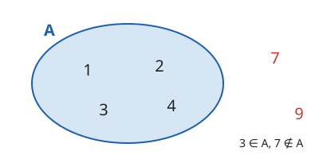

# Množina a její zápis

**Co se naučíte**
- co je množina a její prvek,
- používat znaky $\in$ a $\notin$,
- zapsat množinu výčtem prvků i charakteristickou vlastností,
- poznat prázdnou množinu a určit počet prvků konečné množiny,
- rozhodnout, zda se dvě množiny rovnají.

**Co potřebujete znát**
- [přirozená a celá čísla](../../zaklady/01-cisla/vyklad.md#celá-čísla),
- [porovnávání čísel](../../zaklady/01-cisla/vyklad.md#porovnávání-čísel) a znaky $<$, $>$,
- [číselné obory](../../zaklady/04-odmocniny/vyklad.md#iracionální-čísla-a-číselné-obory) $\mathbb{N}, \mathbb{Z}, \mathbb{Q}, \mathbb{R}$.

## Co je množina

V běžném životě často mluvíme o skupině věcí jako o celku: dny v týdnu, žáci ve třídě, sudá čísla. V matematice takové skupině říkáme množina.

**Množina** je soubor objektů, u kterých lze o každém jednoznačně rozhodnout, zda do souboru patří, nebo ne. Objektům v množině říkáme **prvky**.

Množiny značíme velkými písmeny $A, B, M, \dots$, prvky obvykle malými písmeny nebo čísly. Že prvek do množiny patří, zapisujeme znakem $\in$, že nepatří, znakem $\notin$:

$$3 \in A \quad \text{čteme „3 je prvkem } A\text{“}, \qquad 7 \notin A \quad \text{čteme „7 není prvkem } A\text{“}$$

Některé množiny už znáte. Jsou to [číselné obory](../../zaklady/04-odmocniny/vyklad.md#iracionální-čísla-a-číselné-obory): přirozená čísla $\mathbb{N}$, celá čísla $\mathbb{Z}$, racionální čísla $\mathbb{Q}$ a reálná čísla $\mathbb{R}$.

**Příklad.** Rozhodněte, zda platí: $-2 \in \mathbb{N}$, $\ -2 \in \mathbb{Z}$, $\ \frac{1}{3} \in \mathbb{Q}$.

- $-2 \in \mathbb{N}$ neplatí, přirozená čísla nejsou záporná. Správně je $-2 \notin \mathbb{N}$.
- $-2 \in \mathbb{Z}$ platí.
- $\frac{1}{3} \in \mathbb{Q}$ platí, je to zlomek.

> ⚠️ Pozor: „Velká čísla“ nebo „hezké obrázky“ nejsou množiny. Nedá se jednoznačně rozhodnout, co do nich patří. Množina „čísla větší než 100“ už je v pořádku.

## Zápis výčtem prvků

Množinu s nemnoha prvky zapíšeme **výčtem prvků**: prvky vypíšeme do složených závorek a oddělíme čárkami.

$$A = \{1, 2, 3, 4\}, \qquad S = \{\text{jaro}, \text{léto}, \text{podzim}, \text{zima}\}$$

Ve výčtu platí dvě pravidla:

- **Na pořadí nezáleží**: $\{1, 2, 3\} = \{3, 1, 2\}$.
- **Každý prvek se počítá jen jednou**: $\{1, 1, 2\} = \{1, 2\}$. Opakovaný prvek nic nepřidá.

Má-li množina hodně prvků s jasným pravidlem, můžeme použít tři tečky: $\{2, 4, 6, \dots, 20\}$ (sudá čísla od 2 do 20) nebo $\{1, 2, 3, \dots\}$ (pokračuje bez konce).

> ⚠️ Pozor: Pokud jsou prvky desetinná čísla, oddělujte je středníkem, aby se nepletly s desetinnou čárkou: $\{0{,}5;\ 1{,}5;\ 2\}$.

## Zápis charakteristickou vlastností

Množinu můžeme zapsat také vlastností, kterou mají právě její prvky. Takový zápis se nazývá **charakteristická vlastnost**:

$$A = \{x \in \mathbb{N} ;\ x < 5\}$$

Čteme: „$A$ je množina všech přirozených čísel $x$, pro která platí $x < 5$.“ Před středníkem je, odkud prvky bereme, za ním podmínka, kterou musí splnit.

**Příklad.** Zapište výčtem množiny $B = \{x \in \mathbb{N} ;\ x \text{ je dělitelem čísla } 12\}$ a $C = \{x \in \mathbb{Z} ;\ -2 \le x < 3\}$.

- $B = \{1, 2, 3, 4, 6, 12\}$: všechna přirozená čísla, kterými lze 12 vydělit beze zbytku.
- $C = \{-2, -1, 0, 1, 2\}$: $-2$ patří (znak $\le$ znamená „menší nebo rovno“), $3$ už ne (znak $<$).

Na tom, odkud prvky bereme, záleží. Podmínka $x < 3$ dává v $\mathbb{N}$ množinu $\{1, 2\}$, v $\mathbb{Z}$ nekonečnou množinu $\{\dots, -1, 0, 1, 2\}$ a v $\mathbb{R}$ všechna reálná čísla menší než 3, která výčtem zapsat vůbec nejde.

**Příklad.** Zapište charakteristickou vlastností množinu $D = \{5, 10, 15, 20, \dots\}$.

Jsou to přirozené násobky pěti: $D = \{x \in \mathbb{N} ;\ x \text{ je dělitelné } 5\}$.

## Prázdná množina a počet prvků

Množina, která nemá žádný prvek, se nazývá **prázdná množina** a značí se $\emptyset$. Vznikne třeba, když podmínku nesplní žádné číslo:

$$\{x \in \mathbb{N} ;\ x < 1\} = \emptyset$$

Množina je **konečná**, když má konečný počet prvků. Tento počet značíme $|A|$ a čteme „počet prvků množiny $A$“. Množina, která konečná není (např. $\mathbb{N}$), je **nekonečná**.

**Příklad.** Určete počet prvků: $A = \{a, b, c\}$, $\ B = \{1, 1, 2, 2, 3\}$, $\ \emptyset$, $\ \{\emptyset\}$.

- $|A| = 3$.
- $|B| = 3$: prvky jsou jen $1, 2, 3$, opakování se nepočítá.
- $|\emptyset| = 0$.
- $|\{\emptyset\}| = 1$: je to množina, která obsahuje jeden prvek, a tím je prázdná množina.

> ⚠️ Pozor: $\emptyset$ a $\{\emptyset\}$ nejsou totéž. Prázdná krabice není totéž co krabice, ve které leží prázdná krabice.

## Rovnost množin

Dvě množiny se **rovnají** ($A = B$), když mají přesně stejné prvky: každý prvek $A$ je v $B$ a každý prvek $B$ je v $A$. Na zápisu nezáleží.

**Příklad.** Rozhodněte, zda se rovnají:

- $\{1, 2, 3\}$ a $\{x \in \mathbb{N} ;\ x \le 3\}$: ano, druhá množina je také $\{1, 2, 3\}$.
- $\{2, 4\}$ a $\{2, 4, 6\}$: ne, číslo $6$ je jen ve druhé množině.
- $\{x \in \mathbb{Z} ;\ x^2 = 4\}$ a $\{-2, 2\}$: ano, $(-2)^2 = 4$ i $2^2 = 4$.

## Shrnutí

- **Množina** je soubor prvků, o kterých lze jednoznačně rozhodnout, zda do něj patří. $a \in A$ (patří), $a \notin A$ (nepatří).
- Zápis **výčtem** $\{1, 2, 3\}$: na pořadí ani opakování nezáleží.
- Zápis **vlastností** $\{x \in \mathbb{N} ;\ x < 4\}$: před středníkem odkud, za ním podmínka.
- $\emptyset$ je prázdná množina; $|A|$ je počet prvků konečné množiny.
- $A = B$, když mají přesně stejné prvky.

---

Procvičte si látku: [Příklady ke kapitole Množina a její zápis](priklady.md)
