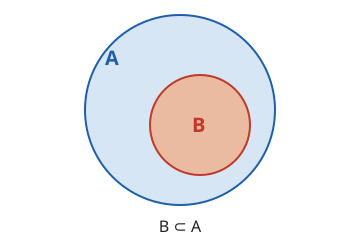
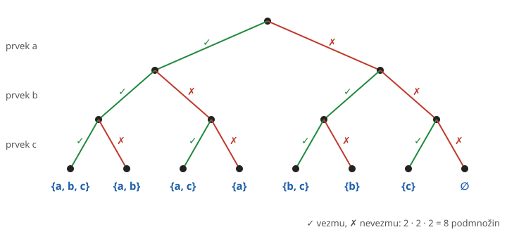

# Vztahy mezi množinami

**Co se naučíte**
- rozhodnout, zda je jedna množina podmnožinou druhé,
- rozlišit znaky $\in$ a $\subset$,
- poznat vlastní podmnožinu a popsat vztah rovnosti pomocí podmnožin,
- vypsat všechny podmnožiny dané množiny a určit jejich počet.

**Co potřebujete znát**
- [množinu, prvek a zápis množin](../01-mnozina-a-jeji-zapis/vyklad.md),
- [prázdnou množinu a počet prvků](../01-mnozina-a-jeji-zapis/vyklad.md#prázdná-množina-a-počet-prvků),
- [mocniny](../../zaklady/03-mocniny/vyklad.md#co-je-mocnina).

## Podmnožina

Množina $B$ je **podmnožinou** množiny $A$, jestliže každý prvek množiny $B$ je také prvkem množiny $A$. Zapisujeme

$$B \subset A$$

a čteme „$B$ je podmnožinou $A$“ nebo „$B$ je částí $A$“. Když $B$ podmnožinou $A$ není, píšeme $B \not\subset A$.

Ve Vennově diagramu leží kruh $B$ celý uvnitř kruhu $A$:

**Příklad.** Je dáno $M = \{1, 2, 3, 4, 5\}$. Rozhodněte, zda $\{2, 4\} \subset M$ a $\{4, 6\} \subset M$.

- $\{2, 4\} \subset M$, protože $2 \in M$ i $4 \in M$.
- $\{4, 6\} \not\subset M$, protože $6 \notin M$. Stačí jediný prvek, který v $M$ chybí.

Podmnožiny znáte i z číselných oborů: každé přirozené číslo je celé, každé celé je racionální a každé racionální je reálné, proto

$$\mathbb{N} \subset \mathbb{Z} \subset \mathbb{Q} \subset \mathbb{R}$$

> ℹ️ V některých knihách se podmnožina značí $\subseteq$. Znamená totéž co $\subset$ v této učebnici.

## Prvek, nebo podmnožina?

Znaky $\in$ a $\subset$ se snadno pletou. Rozdíl je v tom, co stojí vlevo:

- $\in$ píšeme mezi **prvek** a množinu: $2 \in \{1, 2, 3\}$,
- $\subset$ píšeme mezi **dvě množiny**: $\{2\} \subset \{1, 2, 3\}$.

**Příklad.** Rozhodněte, zda platí, pro $A = \{1, 2, 3\}$:

- $1 \in A$ platí.
- $\{1\} \in A$ neplatí: prvky $A$ jsou čísla, množina $\{1\}$ mezi nimi není.
- $\{1\} \subset A$ platí.
- $1 \subset A$ je chybný zápis: číslo 1 není množina.

> ⚠️ Pozor: Před znak $\subset$ vždy patří množina, tedy něco ve složených závorkách nebo velké písmeno.

## Vlastnosti podmnožin

Z definice plynou tři důležité vlastnosti:

1. **Každá množina je podmnožinou sama sebe**: $A \subset A$. Každý prvek $A$ je přece v $A$.
2. **Prázdná množina je podmnožinou každé množiny**: $\emptyset \subset A$. Nemá žádný prvek, který by v $A$ chyběl.
3. **Platí-li $C \subset B$ a $B \subset A$, pak $C \subset A$.** Například z $\mathbb{N} \subset \mathbb{Z}$ a $\mathbb{Z} \subset \mathbb{Q}$ plyne $\mathbb{N} \subset \mathbb{Q}$.

Pomocí podmnožin lze popsat i **rovnost množin**: dvě množiny se rovnají, právě když každá je podmnožinou té druhé.

$$A = B \quad \Leftrightarrow \quad A \subset B \ \text{ a zároveň } \ B \subset A$$

Znak $\Leftrightarrow$ čtěte „právě když“: obě strany platí současně, nebo současně neplatí.

Podmnožina $B \subset A$, která se nerovná $A$, se nazývá **vlastní podmnožina**. V $A$ je tedy aspoň jeden prvek, který v $B$ chybí. Například $\{1, 2\}$ je vlastní podmnožinou $\{1, 2, 3\}$, ale $\{1, 2, 3\}$ není vlastní podmnožinou sama sebe.

## Všechny podmnožiny dané množiny

Někdy potřebujeme vypsat všechny podmnožiny dané množiny. Abychom žádnou nevynechali, postupujeme podle počtu prvků: nejdřív prázdná množina, pak jednoprvkové, dvouprvkové atd.

**Příklad.** Vypište všechny podmnožiny množiny $A = \{a, b, c\}$.

| počet prvků | podmnožiny |
|---|---|
| 0 | $\emptyset$ |
| 1 | $\{a\}$, $\{b\}$, $\{c\}$ |
| 2 | $\{a, b\}$, $\{a, c\}$, $\{b, c\}$ |
| 3 | $\{a, b, c\}$ |

Celkem je jich $1 + 3 + 3 + 1 = 8$.

Proč právě 8? Při tvoření podmnožiny se u každého prvku rozhodujeme ze dvou možností: prvek **vezmeme**, nebo **nevezmeme**. U tří prvků je to $2 \cdot 2 \cdot 2 = 2^3 = 8$ různých rozhodnutí a každé dává jinou podmnožinu.

Obecně platí:

$$\text{množina s } n \text{ prvky má } 2^n \text{ podmnožin}$$

Množina všech podmnožin množiny $A$ se nazývá **potenční množina** a značí se $\mathcal{P}(A)$. Pro $A = \{a, b\}$ je

$$\mathcal{P}(A) = \{\emptyset, \{a\}, \{b\}, \{a, b\}\}, \qquad |\mathcal{P}(A)| = 2^2 = 4$$

**Příklad.** Kolik podmnožin má množina dnů v týdnu?

Týden má 7 dní, podmnožin je $2^7 = 128$.

> ⚠️ Pozor: Mezi podmnožiny patří vždy i $\emptyset$ a celá množina $A$. Na ty se při vypisování nejčastěji zapomíná.

## Shrnutí

- $B \subset A$, když každý prvek $B$ je i prvkem $A$; jediný chybějící prvek stačí k $B \not\subset A$.
- $\in$ je mezi prvkem a množinou, $\subset$ mezi dvěma množinami.
- $A \subset A$, $\ \emptyset \subset A$; z $C \subset B$ a $B \subset A$ plyne $C \subset A$.
- $A = B \Leftrightarrow A \subset B$ a $B \subset A$.
- Množina s $n$ prvky má $2^n$ podmnožin; všechny tvoří potenční množinu $\mathcal{P}(A)$.

---

Procvičte si látku: [Příklady ke kapitole Vztahy mezi množinami](priklady.md)
