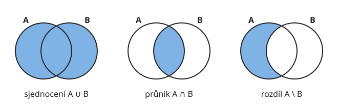
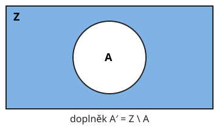
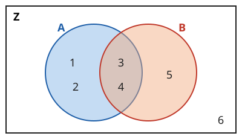
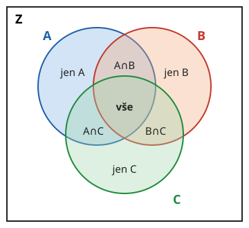

# Operace s množinami

**Co se naučíte**
- určit sjednocení, průnik a rozdíl dvou množin,
- určit doplněk množiny v základní množině,
- znázornit operace Vennovým diagramem,
- používat zákony pro počítání s množinami včetně De Morganových,
- řešit slovní úlohy pomocí Vennova diagramu a vzorce pro počet prvků sjednocení.

**Co potřebujete znát**
- [zápis množin a počet prvků](../01-mnozina-a-jeji-zapis/vyklad.md),
- [podmnožinu](../02-vztahy-mezi-mnozinami/vyklad.md#podmnožina).

## Sjednocení a průnik

S množinami můžeme „počítat“ podobně jako s čísly. Výsledkem operace je zase množina. Operace si dobře představíte na **Vennově diagramu**, kde množiny kreslíme jako kruhy.

**Sjednocení** množin $A$ a $B$ je množina všech prvků, které patří **aspoň do jedné** z nich. Značí se $A \cup B$:

$$A \cup B = \{x ;\ x \in A \ \text{ nebo } \ x \in B\}$$

**Průnik** množin $A$ a $B$ je množina všech prvků, které patří **do obou** současně. Značí se $A \cap B$:

$$A \cap B = \{x ;\ x \in A \ \text{ a zároveň } \ x \in B\}$$

Když mají dvě množiny prázdný průnik ($A \cap B = \emptyset$), nazývají se **disjunktní**. Nemají žádný společný prvek.

**Příklad.** Je dáno $A = \{1, 2, 3, 4\}$ a $B = \{3, 4, 5\}$. Určete $A \cup B$ a $A \cap B$.

- $A \cup B = \{1, 2, 3, 4, 5\}$: vezmeme všechny prvky z obou množin, společné jen jednou.
- $A \cap B = \{3, 4\}$: prvky, které jsou v obou.

> ⚠️ Pozor: Sjednocení si pamatujte jako „nebo“ (stačí v jedné), průnik jako „a zároveň“ (musí být v obou). Znak $\cup$ připomíná hrnek, do kterého se vejde všechno.

## Rozdíl množin

**Rozdíl** množin $A$ a $B$ je množina prvků, které patří do $A$, ale **nepatří** do $B$. Značí se $A \setminus B$ (čteme „$A$ bez $B$“):

$$A \setminus B = \{x ;\ x \in A \ \text{ a zároveň } \ x \notin B\}$$

**Příklad.** Pro $A = \{1, 2, 3, 4\}$ a $B = \{3, 4, 5\}$ určete $A \setminus B$ a $B \setminus A$.

- $A \setminus B = \{1, 2\}$: z $A$ odebereme vše, co je i v $B$.
- $B \setminus A = \{5\}$.

> ⚠️ Pozor: U rozdílu záleží na pořadí, $A \setminus B$ a $B \setminus A$ jsou obvykle různé množiny. U sjednocení a průniku na pořadí nezáleží.

## Doplněk

Často pracujeme uvnitř nějaké větší množiny, ze které bereme všechny prvky. Říkáme jí **základní množina** a značíme ji $Z$. Ve Vennově diagramu ji kreslíme jako obdélník.

**Doplněk** množiny $A \subset Z$ je množina všech prvků $Z$, které nepatří do $A$. Značí se $A'$:

$$A' = Z \setminus A$$

**Příklad.** Je dáno $Z = \{1, 2, 3, 4, 5, 6\}$, $A = \{1, 2, 3, 4\}$ a $B = \{3, 4, 5\}$. Určete $A'$ a $B'$.

- $A' = \{5, 6\}$
- $B' = \{1, 2, 6\}$

Prvek $6$ nepatří ani do $A$, ani do $B$, proto ve Vennově diagramu leží mimo oba kruhy.

Pro doplněk platí: $(A')' = A$, $\ A \cup A' = Z$, $\ A \cap A' = \emptyset$.

**Příklad.** Základní množina je $\mathbb{N}$ a $S$ je množina sudých čísel. Určete $S'$.

$S'$ jsou přirozená čísla, která nejsou sudá, tedy lichá čísla: $S' = \{1, 3, 5, 7, \dots\}$.

## Zákony pro počítání s množinami

Pro operace s množinami platí podobná pravidla jako pro sčítání a násobení čísel:

| zákon | sjednocení | průnik |
|---|---|---|
| komutativní (na pořadí nezáleží) | $A \cup B = B \cup A$ | $A \cap B = B \cap A$ |
| asociativní (na závorkách nezáleží) | $(A \cup B) \cup C = A \cup (B \cup C)$ | $(A \cap B) \cap C = A \cap (B \cap C)$ |
| distributivní | $A \cup (B \cap C) = (A \cup B) \cap (A \cup C)$ | $A \cap (B \cup C) = (A \cap B) \cup (A \cap C)$ |
| s prázdnou množinou | $A \cup \emptyset = A$ | $A \cap \emptyset = \emptyset$ |

Zvlášť užitečné jsou **De Morganovy zákony**. Říkají, jak určit doplněk sjednocení a průniku:

$$(A \cup B)' = A' \cap B', \qquad (A \cap B)' = A' \cup B'$$

Slovy: při doplňku se sjednocení mění na průnik a naopak.

**Příklad.** Ověřte první De Morganův zákon pro $Z = \{1, \dots, 6\}$, $A = \{1, 2, 3, 4\}$, $B = \{3, 4, 5\}$.

- Levá strana: $A \cup B = \{1, 2, 3, 4, 5\}$, takže $(A \cup B)' = \{6\}$.
- Pravá strana: $A' = \{5, 6\}$, $B' = \{1, 2, 6\}$, takže $A' \cap B' = \{6\}$.

Obě strany se rovnají.

Smysl zákona je dobře vidět v řeči: „není pravda, že prší nebo sněží“ znamená totéž co „neprší a zároveň nesněží“.

> ⚠️ Pozor: $(A \cup B)' \ne A' \cup B'$. Doplněk nelze jen „roznásobit“ do závorky, operace se musí změnit.

## Počet prvků sjednocení

Chceme-li spočítat prvky sjednocení dvou konečných množin, nestačí sečíst $|A| + |B|$. Prvky průniku bychom tak započítali dvakrát. Proto je jednou odečteme:

$$|A \cup B| = |A| + |B| - |A \cap B|$$

Pro disjunktní množiny je $|A \cap B| = 0$ a platí jednoduše $|A \cup B| = |A| + |B|$.

**Příklad.** Ve třídě je 30 žáků. Angličtinu se učí 18 žáků, němčinu 15 žáků a oba jazyky 7 žáků. Kolik žáků se neučí ani jeden z těchto jazyků?

Označme $A$ žáky učící se angličtinu a $N$ žáky učící se němčinu. Vennův diagram vyplňujeme **od průniku**:

- oba jazyky: $7$,
- jen angličtinu: $18 - 7 = 11$,
- jen němčinu: $15 - 7 = 8$.

Aspoň jeden jazyk se učí $|A \cup N| = 18 + 15 - 7 = 26$ žáků. Ani jeden se neučí $30 - 26 = 4$ žáci.

U tří množin postupujeme stejně: diagram má sedm oblastí a vyplňujeme ho od středu (prvky ve všech třech množinách) směrem ven.

## Shrnutí

- $A \cup B$: prvky aspoň v jedné množině („nebo“); $\ A \cap B$: prvky v obou („a zároveň“).
- $A \setminus B$: prvky v $A$, které nejsou v $B$; na pořadí záleží.
- $A' = Z \setminus A$: doplněk v základní množině $Z$.
- Disjunktní množiny: $A \cap B = \emptyset$.
- De Morgan: $(A \cup B)' = A' \cap B'$, $\ (A \cap B)' = A' \cup B'$.
- $|A \cup B| = |A| + |B| - |A \cap B|$; Vennův diagram vyplňujte od průniku.

---

Procvičte si látku: [Příklady ke kapitole Operace s množinami](priklady.md)
