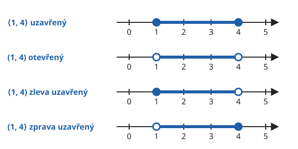
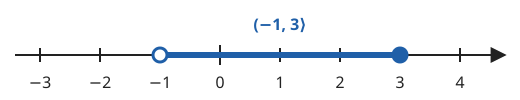
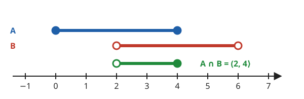

# Intervaly

**Co se naučíte**
- co je interval a jak se zapisuje,
- rozlišit uzavřený, otevřený a polouzavřený interval,
- zapsat neomezený interval pomocí $\infty$,
- převést nerovnost na interval a naopak a znázornit interval na číselné ose,
- určit průnik, sjednocení, rozdíl a doplněk intervalů.

**Co potřebujete znát**
- [reálná čísla](../../zaklady/04-odmocniny/vyklad.md#iracionální-čísla-a-číselné-obory) a [číselnou osu](../../zaklady/01-cisla/vyklad.md#číselná-osa),
- [zápis množiny charakteristickou vlastností](../01-mnozina-a-jeji-zapis/vyklad.md#zápis-charakteristickou-vlastností),
- [operace s množinami](../03-operace-s-mnozinami/vyklad.md).

## Co je interval

Množina $\{x \in \mathbb{R} ;\ 1 \le x \le 3\}$ obsahuje všechna reálná čísla mezi 1 a 3: celá čísla $1, 2, 3$, ale i $1{,}5$, $\sqrt{2}$, $2{,}999$ a nekonečně mnoho dalších. Výčtem ji zapsat nejde. Na číselné ose ale tvoří souvislý úsek.

Množina reálných čísel, která na číselné ose tvoří souvislý úsek, se nazývá **interval**. Zapisuje se pomocí **krajních bodů** $a < b$ a závorek, které říkají, zda krajní bod do intervalu patří.

K zápisu potřebujeme kromě znaků $<$ a $>$ i znaky $\le$ („menší nebo rovno“) a $\ge$ („větší nebo rovno“).

## Druhy intervalů

| interval | zápis nerovností | krajní body | na ose |
|---|---|---|---|
| uzavřený $\langle a, b \rangle$ | $a \le x \le b$ | oba patří | ● — ● |
| otevřený $(a, b)$ | $a < x < b$ | ani jeden nepatří | ○ — ○ |
| zleva uzavřený $\langle a, b)$ | $a \le x < b$ | patří jen $a$ | ● — ○ |
| zprava uzavřený $(a, b \rangle$ | $a < x \le b$ | patří jen $b$ | ○ — ● |

**Špičatá závorka** $\langle\ \rangle$ znamená, že krajní bod do intervalu **patří**. Na ose ho kreslíme plným kroužkem.

**Kulatá závorka** $(\ )$ znamená, že krajní bod **nepatří**. Na ose ho kreslíme prázdným kroužkem.

**Příklad.** Zapište intervalem množinu $\{x \in \mathbb{R} ;\ -1 < x \le 3\}$ a znázorněte ji.

Číslo $-1$ do množiny nepatří (ostrá nerovnost $<$), číslo $3$ ano ($\le$). Je to interval $(-1, 3\rangle$.

> ⚠️ Pozor: Interval $(2, 5)$ obsahuje nekonečně mnoho čísel, třeba $2{,}1$ nebo $4{,}999$. Nezaměňujte ho s množinou $\{3, 4\}$, která obsahuje jen celá čísla mezi 2 a 5.

> ⚠️ Pozor: V zahraniční literatuře se místo $\langle a, b \rangle$ píše $[a, b]$. Význam je stejný.

## Neomezené intervaly

Interval může pokračovat bez konce na jednu nebo na obě strany. Používáme k tomu znak $\infty$ (**nekonečno**). Znak $\infty$ ale není číslo, jen říká „bez konce“. Proto u něj stojí **vždy kulatá závorka**.

| interval | zápis nerovností |
|---|---|
| $\langle a, \infty)$ | $x \ge a$ |
| $(a, \infty)$ | $x > a$ |
| $(-\infty, b \rangle$ | $x \le b$ |
| $(-\infty, b)$ | $x < b$ |
| $(-\infty, \infty)$ | všechna reálná čísla, $\mathbb{R}$ |

**Příklad.** Zapište intervalem: $x \ge 2$ a $x < -1$.

- $x \ge 2$: $\langle 2, \infty)$. Dvojka patří, vpravo to pokračuje bez konce.
- $x < -1$: $(-\infty, -1)$.

> ⚠️ Pozor: Zápis $\langle 2, \infty \rangle$ je chybný. Nekonečno není číslo, takže „do intervalu patřit“ nemůže.

## Průnik a sjednocení intervalů

Intervaly jsou množiny, takže s nimi můžeme dělat všechny [operace s množinami](../03-operace-s-mnozinami/vyklad.md). Nejjistější postup je **nakreslit si oba intervaly nad jednu číselnou osu** a výsledek z obrázku vyčíst.

- **Průnik** je úsek, kde se intervaly překrývají.
- **Sjednocení** je vše, co pokrývá aspoň jeden z nich.

**Příklad.** Určete průnik a sjednocení intervalů $A = \langle 0, 4 \rangle$ a $B = (2, 6)$.

- $A \cap B = (2, 4\rangle$. Bod 2 nepatří do $B$, proto ani do průniku. Bod 4 patří do obou.
- $A \cup B = \langle 0, 6)$. Bod 0 patří do $A$, bod 6 nepatří ani do jednoho.

Rozhodování o krajním bodu průniku nebo sjednocení: podívejte se, do kterých intervalů bod patří. Do průniku patří, jen když patří do **obou**. Do sjednocení patří, když patří **aspoň do jednoho**.

**Příklad.** Určete průnik a sjednocení intervalů $A = \langle 1, 2 \rangle$ a $B = (3, 5)$.

Intervaly se nepřekrývají, mezi 2 a 3 je mezera.

- $A \cap B = \emptyset$
- Sjednocení nejde zapsat jedním intervalem: $A \cup B = \langle 1, 2 \rangle \cup (3, 5)$.

## Rozdíl a doplněk intervalů

**Příklad.** Určete $A \setminus B$ pro $A = \langle 0, 5 \rangle$ a $B = \langle 3, 7)$.

Z intervalu $A$ odebereme vše, co leží v $B$, tedy čísla od 3 výš. Zbudou čísla od 0 do 3, přičemž 3 už odebrána byla:

$$A \setminus B = \langle 0, 3)$$

Krajní bod, který jsme odebrali, se v rozdílu „otočí“: v $B$ byl uzavřený, v rozdílu je otevřený.

**Doplněk** intervalu v $\mathbb{R}$ jsou všechna reálná čísla mimo něj.

**Příklad.** Určete doplněk intervalu $A = \langle -2, 3)$ v $\mathbb{R}$.

Mimo interval leží čísla menší než $-2$ a čísla od 3 výš:

$$A' = (-\infty, -2) \cup \langle 3, \infty)$$

I tady se závorky u krajních bodů otočí: $-2$ do $A$ patří, proto do doplňku ne, a u čísla $3$ je to naopak.

## Shrnutí

- Interval je souvislý úsek číselné osy; krajní body $a < b$.
- $\langle\ \rangle$: krajní bod patří (● plný kroužek); $(\ )$: nepatří (○ prázdný kroužek).
- $\le, \ge$ → špičatá závorka; $<, >$ → kulatá závorka.
- U $\pm\infty$ je vždy kulatá závorka; $\mathbb{R} = (-\infty, \infty)$.
- Průnik, sjednocení i rozdíl intervalů vyčtěte z obrázku nad jednou osou.
- V rozdílu a doplňku se závorka u odebraného krajního bodu otočí.

---

Procvičte si látku: [Příklady ke kapitole Intervaly](priklady.md)
