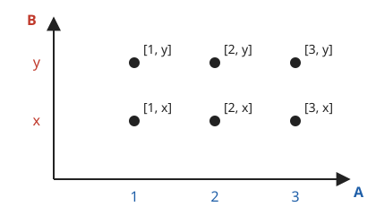
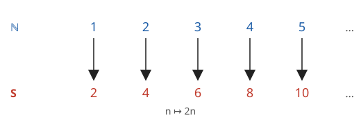

# Kartézský součin a mohutnost ⭐

Tato kapitola je rozšiřující. První dvě sekce budete potřebovat u [funkcí](../../funkce/), sekce o nekonečných množinách je pro zvídavé.

**Co se naučíte**
- co je uspořádaná dvojice a čím se liší od dvouprvkové množiny,
- určit kartézský součin dvou množin a počet jeho prvků,
- znázornit kartézský součin v mřížce a pochopit, proč je rovina $\mathbb{R} \times \mathbb{R}$,
- porovnat velikost množin pomocí párování prvků,
- vysvětlit, proč existují „různě velká“ nekonečna.

**Co potřebujete znát**
- [zápis množin a počet prvků](../01-mnozina-a-jeji-zapis/vyklad.md#prázdná-množina-a-počet-prvků),
- [podmnožinu](../02-vztahy-mezi-mnozinami/vyklad.md#podmnožina),
- [číselné obory](../../zaklady/04-odmocniny/vyklad.md#iracionální-čísla-a-číselné-obory) a [číselnou osu](../../zaklady/01-cisla/vyklad.md#číselná-osa).

## Uspořádaná dvojice

V množině nezáleží na pořadí: $\{1, 2\} = \{2, 1\}$. Někdy na pořadí ale záležet musí. Datum 3. 5. je jiné než 5. 3., políčko šachovnice „sloupec c, řádek 4“ je jiné než „sloupec 4, řádek c“.

**Uspořádaná dvojice** $[a, b]$ je dvojice prvků, u které záleží na pořadí. Prvek $a$ je **první složka**, $b$ **druhá složka**.

Dvě uspořádané dvojice se rovnají, jen když se rovnají jejich první složky i druhé složky:

$$[a, b] = [c, d] \quad \Leftrightarrow \quad a = c \ \text{ a zároveň } \ b = d$$

**Příklad.** Rozhodněte, zda platí $[1, 2] = [2, 1]$ a $\{1, 2\} = \{2, 1\}$.

- $[1, 2] \ne [2, 1]$: první složky se liší.
- $\{1, 2\} = \{2, 1\}$: u množin na pořadí nezáleží.

Na rozdíl od množiny se složky dvojice mohou opakovat: $[3, 3]$ je v pořádku.

> ℹ️ V některých knihách se uspořádaná dvojice zapisuje kulatými závorkami $(a, b)$. V této učebnici kulaté závorky používáme pro [otevřené intervaly](../04-intervaly/vyklad.md#druhy-intervalů), proto píšeme hranaté.

## Kartézský součin

**Kartézský součin** množin $A$ a $B$ je množina všech uspořádaných dvojic, jejichž první složka je z $A$ a druhá z $B$:

$$A \times B = \{[a, b] ;\ a \in A,\ b \in B\}$$

Čteme „$A$ krát $B$“. Název je podle francouzského matematika René Descarta (latinsky Cartesius).

**Příklad.** Je dáno $A = \{1, 2, 3\}$ a $B = \{x, y\}$. Určete $A \times B$.

Ke každému prvku $A$ přiřadíme postupně každý prvek $B$:

$$A \times B = \{[1, x], [1, y], [2, x], [2, y], [3, x], [3, y]\}$$

Přehledně ho znázorníme v mřížce: prvky $A$ na vodorovné ose, prvky $B$ na svislé, každá dvojice je jeden bod.

Z mřížky je vidět i počet prvků: 3 sloupce krát 2 řádky. Obecně pro konečné množiny platí

$$|A \times B| = |A| \cdot |B|$$

> ⚠️ Pozor: $A \times B$ a $B \times A$ jsou obvykle různé množiny. V $B \times A$ jsou dvojice $[x, 1], [y, 1], \dots$, tedy s prohozenými složkami. Počet prvků je ale stejný.

**Příklad.** V restauraci nabízejí 4 polévky a 5 hlavních jídel. Kolik různých obědů (polévka a hlavní jídlo) lze sestavit?

Každý oběd je dvojice [polévka, hlavní jídlo], tedy prvek kartézského součinu. Obědů je $4 \cdot 5 = 20$.

## Rovina jako kartézský součin

Vezměme kartézský součin $\mathbb{R} \times \mathbb{R}$. Jeho prvky jsou dvojice reálných čísel $[x, y]$. Když jednu číselnou osu nakreslíme vodorovně a druhou svisle, odpovídá každé dvojici právě jeden bod roviny. Například dvojice $[2, 3]$ je bod, ke kterému dojdeme o 2 doprava a o 3 nahoru.

Takto vzniká **kartézská soustava souřadnic**, na které budeme kreslit [grafy funkcí](../../funkce/). Proto se $\mathbb{R} \times \mathbb{R}$ často zapisuje $\mathbb{R}^2$.

## Kdy mají množiny stejně prvků

Jak poznat, že dvě množiny mají stejně prvků, aniž bychom je počítali? Stačí prvky **spárovat** tak, aby každý prvek první množiny měl právě jednoho partnera ve druhé a naopak. Takové párování se nazývá **vzájemně jednoznačné přiřazení** (bijekce).

Takhle to dělá i malé dítě, které ještě neumí počítat: když má každá židle u stolu právě jedno dítě a nikdo nestojí, je dětí stejně jako židlí.

Množiny, mezi kterými existuje vzájemně jednoznačné přiřazení, mají **stejnou mohutnost**. Pro konečné množiny to znamená prostě stejný počet prvků.

## Nekonečné množiny

U nekonečných množin vede párování k překvapivým výsledkům.

**Příklad.** Mají $\mathbb{N}$ a množina sudých čísel $S = \{2, 4, 6, \dots\}$ stejnou mohutnost?

Spárujeme každé přirozené číslo $n$ s číslem $2n$:

Každé přirozené číslo má právě jednoho partnera a každé sudé číslo je partnerem právě jednoho přirozeného čísla. Množiny mají **stejnou mohutnost**, přestože $S$ je vlastní podmnožinou $\mathbb{N}$. U konečných množin by to nebylo možné.

Nekonečná množina, kterou lze takto spárovat s $\mathbb{N}$, se nazývá **spočetná**. Její prvky jde „očíslovat“ $1., 2., 3., \dots$ a dojít tak ke každému z nich. Spočetná je i množina celých čísel:

$$0,\ 1,\ -1,\ 2,\ -2,\ 3,\ -3,\ \dots$$

Spočetná je dokonce i množina $\mathbb{Q}$ všech zlomků, i když je jich zdánlivě mnohem víc.

## Různě velká nekonečna

Německý matematik **Georg Cantor**, zakladatel teorie množin, dokázal v 19. století, že **reálná čísla spočetná nejsou**. Ať se je pokusíme očíslovat jakkoli, vždy nějaké číslo vynecháme.

Myšlenka důkazu (tzv. **diagonální metoda**): Představme si, že bychom měli očíslovaný seznam všech čísel z intervalu $(0, 1)$ v desetinném zápisu:

| pořadí | číslo |
|---|---|
| 1. | $0{,}\mathbf{5}1384\ldots$ |
| 2. | $0{,}2\mathbf{7}190\ldots$ |
| 3. | $0{,}33\mathbf{3}33\ldots$ |
| 4. | $0{,}809\mathbf{4}2\ldots$ |
| … | … |

Sestavme nové číslo tak, že jeho 1. desetinná číslice se liší od 1. číslice prvního čísla, 2. číslice od 2. číslice druhého čísla a tak dál (třeba vždy napíšeme 1, kromě případu, kdy tam byla 1, pak napíšeme 2): $0{,}1111\ldots$

Toto číslo se od každého čísla v seznamu liší aspoň v jedné číslici, takže v seznamu není. Seznam tedy nebyl úplný. Proto reálných čísel je „víc“ než přirozených.

Existují tedy aspoň dvě různě velká nekonečna: spočetné (jako $\mathbb{N}$, $\mathbb{Z}$, $\mathbb{Q}$) a nespočetné (jako $\mathbb{R}$). Cantor dokonce ukázal, že potenční množina $\mathcal{P}(A)$ má vždy větší mohutnost než $A$. Nekonečen je tedy nekonečně mnoho.

## Shrnutí

- Uspořádaná dvojice $[a, b]$: záleží na pořadí; $[a, b] = [c, d] \Leftrightarrow a = c$ a $b = d$.
- $A \times B = \{[a, b] ;\ a \in A,\ b \in B\}$; $\ |A \times B| = |A| \cdot |B|$.
- $\mathbb{R} \times \mathbb{R} = \mathbb{R}^2$ odpovídá bodům roviny.
- Stejná mohutnost = existuje vzájemně jednoznačné přiřazení (párování) prvků.
- $\mathbb{N}$, $\mathbb{Z}$, $\mathbb{Q}$ jsou spočetné; $\mathbb{R}$ je nespočetná (Cantor).

---

Procvičte si látku: [Příklady ke kapitole Kartézský součin a mohutnost](priklady.md)
