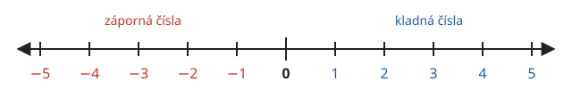

# Čísla

**Co se naučíte**
- rozlišit přirozená a celá čísla a vysvětlit, co znamená zápis v desítkové soustavě,
- znázornit čísla na číselné ose a porovnat je,
- určit absolutní hodnotu čísla,
- sčítat, odčítat, násobit a dělit celá čísla včetně záporných,
- spočítat výraz se správným pořadím početních operací.

## Přirozená čísla a nula

Čísla, kterými počítáme předměty (1, 2, 3, 4, …), se nazývají **přirozená čísla**. Jejich množinu značíme $\mathbb{N}$:

$$\mathbb{N} = \{1, 2, 3, 4, \dots\}$$

Tři tečky znamenají „a tak dál bez konce“. Největší přirozené číslo neexistuje, protože ke každému lze přičíst 1.

Číslo **nula** (0) vyjadřuje, že nemáme nic. V české škole se mezi přirozená čísla nepočítá. Když ji chceme přidat, píšeme $\mathbb{N}_0 = \{0, 1, 2, 3, \dots\}$.

**Příklad.** Patří čísla 7, 0 a 1 000 do $\mathbb{N}$?
Čísla 7 a 1 000 ano. Nula ne, ta patří jen do $\mathbb{N}_0$.

## Desítková soustava

Čísla zapisujeme pomocí deseti **číslic** 0, 1, 2, …, 9. Hodnota číslice závisí na tom, na kterém místě (v jakém **řádu**) stojí:

| řád | tisíce | stovky | desítky | jednotky |
|---|---|---|---|---|
| hodnota | $1\,000$ | $100$ | $10$ | $1$ |

Každý řád je desetkrát větší než řád napravo od něj, proto se soustava jmenuje **desítková**.

**Příklad.** Rozložte číslo 2 305 do řádů.

$$2\,305 = 2 \cdot 1\,000 + 3 \cdot 100 + 0 \cdot 10 + 5 \cdot 1$$

Nula na místě desítek je důležitá: bez ní by vzniklo jiné číslo, 235.

> ⚠️ Pozor: Velká čísla se v češtině dělí mezerou po trojicích od konce (2 305, 1 250 000). Tečka ani čárka se k tomu nepoužívá, čárka je vyhrazena pro desetinná čísla.

## Číselná osa

Čísla si můžeme představit jako body na přímce, na **číselné ose**. Zvolíme bod 0 a stejně dlouhé dílky. Doprava od nuly leží čísla 1, 2, 3, …, doleva čísla, která jsou menší než nula.

Čím je číslo na ose víc vpravo, tím je větší.

## Porovnávání čísel

Pro porovnání dvou čísel používáme znaky:

| znak | čte se | příklad |
|---|---|---|
| $<$ | je menší než | $3 < 8$ |
| $>$ | je větší než | $8 > 3$ |
| $=$ | se rovná | $5 = 5$ |

Znak $<$ nebo $>$ se vždy „otevírá“ k většímu číslu.

**Pravidlo.** Ze dvou čísel je větší to, které leží na číselné ose víc vpravo.

**Příklad.** Porovnejte 1 090 a 1 009.
Obě mají 1 tisíc a 0 stovek. V řádu desítek má první číslo 9, druhé 0. Proto $1\,090 > 1\,009$.

## Celá čísla

Čísla vlevo od nuly jsou **záporná čísla**: $-1, -2, -3, \dots$ Píšeme je se znaménkem minus. Čísla vpravo od nuly jsou **kladná** (znaménko plus se obvykle nepíše). Nula není ani kladná, ani záporná.

Přirozená čísla, nula a záporná čísla dohromady tvoří **celá čísla**:

$$\mathbb{Z} = \{\dots, -3, -2, -1, 0, 1, 2, 3, \dots\}$$

Záporná čísla potkáte v běžném životě: teplota $-5\ ^\circ\mathrm{C}$, dluh na účtu, podlaží pod zemí.

**Příklad.** Porovnejte $-7$ a $-3$.
Číslo $-3$ leží blíž k nule, tedy víc vpravo. Proto $-7 < -3$.

> ⚠️ Pozor: U záporných čísel je větší to, které má „menší číslo za mínusem“. Mráz $-3\ ^\circ\mathrm{C}$ je teplejší než $-7\ ^\circ\mathrm{C}$.

## Absolutní hodnota

**Absolutní hodnota** čísla je jeho vzdálenost od nuly na číselné ose. Značí se svislými čarami: $|a|$. Vzdálenost nemůže být záporná, proto absolutní hodnota nikdy není záporná.

**Pravidlo.**
- Kladné číslo a nula: absolutní hodnota je číslo samo, $|5| = 5$, $|0| = 0$.
- Záporné číslo: absolutní hodnota je číslo bez minusu, $|-5| = 5$.

Dvě čísla, která se liší jen znaménkem (třeba $4$ a $-4$), jsou **čísla opačná**. Mají stejnou absolutní hodnotu.

**Příklad.** $|-12| = 12$, $|12| = 12$, $|-12| > |3|$, ale $-12 < 3$.

## Sčítání a odčítání celých čísel

Sčítání si představte jako pohyb po číselné ose: přičíst kladné číslo znamená jít doprava, přičíst záporné číslo jít doleva.

**Pravidla pro sčítání.**
- **Stejná znaménka:** sečtěte absolutní hodnoty a ponechte společné znaménko.
  $(-3) + (-4) = -7$
- **Různá znaménka:** od větší absolutní hodnoty odečtěte menší a dejte výsledku znaménko čísla s větší absolutní hodnotou.
  $-9 + 5 = -4$, $\quad 9 + (-5) = 4$

**Odčítání** převedeme na sčítání: odečíst číslo je totéž jako přičíst číslo opačné.

$$a - b = a + (-b)$$

Odtud plyne často používané pravidlo „dvě minus za sebou dávají plus“:

$$7 - (-2) = 7 + 2 = 9$$

**Příklad.** Spočítejte $-4 - 6$ a $-4 - (-6)$.
- $-4 - 6 = -4 + (-6) = -10$ (stejná znaménka, sečteme 4 a 6)
- $-4 - (-6) = -4 + 6 = 2$ (různá znaménka, $6 - 4 = 2$, převažuje kladné)

> ⚠️ Pozor: Záporné číslo za znaménkem operace pište do závorky: $5 + (-3)$, ne $5 + -3$.

## Násobení a dělení celých čísel

Nejprve vynásobte (vydělte) absolutní hodnoty, potom určete znaménko:

| znaménka | výsledek | příklad |
|---|---|---|
| stejná ($+ \cdot +$ nebo $- \cdot -$) | kladný | $(-3) \cdot (-4) = 12$ |
| různá ($+ \cdot -$ nebo $- \cdot +$) | záporný | $(-3) \cdot 4 = -12$ |

Pro dělení platí stejná pravidla: $(-20) : (-5) = 4$, $\ 20 : (-5) = -4$.

Při násobení více čísel spočítejte záporné činitele. Je-li jich **sudý** počet, je výsledek kladný, je-li jich **lichý** počet, je záporný.

**Příklad.** $(-2) \cdot 3 \cdot (-5) = 30$, protože záporní činitelé jsou dva (sudý počet).

> ⚠️ Pozor: Nulou dělit nelze. Výraz $7 : 0$ nemá smysl. Naopak $0 : 7 = 0$.

## Pořadí početních operací

Když je ve výrazu více operací, počítáme v tomto pořadí:

1. **závorky** (nejdřív nejvnitřnější),
2. **násobení a dělení** zleva doprava,
3. **sčítání a odčítání** zleva doprava.

**Příklad.** Spočítejte $2 + 3 \cdot 4$ a $(2 + 3) \cdot 4$.

$$2 + 3 \cdot 4 = 2 + 12 = 14$$

$$(2 + 3) \cdot 4 = 5 \cdot 4 = 20$$

**Příklad.** Spočítejte $12 : 3 \cdot 2$.
Násobení a dělení mají stejnou přednost, jdeme zleva: $12 : 3 \cdot 2 = 4 \cdot 2 = 8$, ne $12 : 6 = 2$.

## Shrnutí

- $\mathbb{N} = \{1, 2, 3, \dots\}$, $\ \mathbb{N}_0 = \{0, 1, 2, \dots\}$, $\ \mathbb{Z} = \{\dots, -2, -1, 0, 1, 2, \dots\}$.
- V desítkové soustavě je každý řád desetkrát větší než řád vpravo od něj.
- Na číselné ose je větší to číslo, které leží víc vpravo.
- $|a|$ je vzdálenost čísla $a$ od nuly, nikdy není záporná.
- Odčítání je přičítání opačného čísla: $a - b = a + (-b)$.
- Součin i podíl dvou čísel se stejným znaménkem je kladný, s různými znaménky záporný.
- Pořadí operací: závorky → násobení a dělení → sčítání a odčítání.
- Nulou dělit nelze.

---

Procvičte si látku: [Příklady ke kapitole Čísla](priklady.md)
