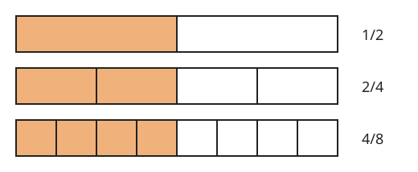

# Zlomky

**Co se naučíte**
- co je zlomek a jak souvisí s dělením,
- rozšiřovat a krátit zlomky a převést je na základní tvar,
- porovnávat zlomky,
- sčítat, odčítat, násobit a dělit zlomky včetně záporných,
- převádět zlomky na desetinná čísla a naopak.

**Co potřebujete znát**
- [celá čísla a číselnou osu](../01-cisla/vyklad.md#celá-čísla),
- [počítání se zápornými čísly](../01-cisla/vyklad.md#násobení-a-dělení-celých-čísel),
- [pořadí početních operací](../01-cisla/vyklad.md#pořadí-početních-operací).

## Co je zlomek

Když celek (pizzu, čokoládu, úsečku) rozdělíme na několik **stejných** dílů a vezmeme z nich některé, vyjádříme to **zlomkem**:

$$\frac{3}{4}$$

- Číslo pod čarou je **jmenovatel**. Říká, na kolik dílů je celek rozdělen.
- Číslo nad čarou je **čitatel**. Říká, kolik takových dílů bereme.
- Čára mezi nimi je **zlomková čára**.

**Příklad.** Čokoláda má 12 kostiček a snědli jste 5. Snědli jste $\frac{5}{12}$ čokolády a zbylo $\frac{7}{12}$.

## Zlomek jako dělení

Zlomková čára znamená totéž co dělení:

$$\frac{a}{b} = a : b$$

Proto platí:
- **Jmenovatel nesmí být nula**, protože nulou dělit nelze.
- Každé celé číslo lze zapsat jako zlomek: $5 = \frac{5}{1} = \frac{10}{2}$.
- Je-li čitatel větší než jmenovatel, je zlomek větší než 1: $\frac{7}{3} > 1$.

Zlomek větší než 1 lze zapsat jako **smíšené číslo**, tedy celou část a zlomek menší než 1. Čitatel vydělíme jmenovatelem se zbytkem:

$$\frac{7}{3} = 7 : 3 = 2 \text{ zbytek } 1, \quad \text{tedy} \quad \frac{7}{3} = 2\tfrac{1}{3}$$

Zpět: $2\tfrac{1}{3} = \frac{2 \cdot 3 + 1}{3} = \frac{7}{3}$.

> ⚠️ Pozor: Smíšené číslo $2\tfrac{1}{3}$ znamená $2 + \frac{1}{3}$, ne $2 \cdot \frac{1}{3}$. Při počítání je bezpečnější převést ho nejdřív na zlomek.

## Rozšiřování a krácení

Stejnou část celku lze vyjádřit různými zlomky:

$$\frac{1}{2} = \frac{2}{4} = \frac{4}{8}$$

**Pravidlo.**
- **Rozšířit** zlomek znamená vynásobit čitatele i jmenovatele stejným číslem (různým od nuly).
- **Krátit** zlomek znamená vydělit čitatele i jmenovatele stejným číslem (různým od nuly).

Hodnota zlomku se přitom nemění.

$$\frac{3}{5} = \frac{3 \cdot 4}{5 \cdot 4} = \frac{12}{20} \qquad \frac{12}{20} = \frac{12 : 4}{20 : 4} = \frac{3}{5}$$

Zlomek, který už nejde dál krátit, je v **základním tvaru**.

Ke krácení se hodí pojem **dělitel**: číslo, kterým lze dané číslo vydělit beze zbytku. Například dělitelé čísla 12 jsou 1, 2, 3, 4, 6, 12. Největší číslo, které dělí dvě čísla zároveň, je jejich **největší společný dělitel** (NSD). Když zlomek zkrátíte NSD čitatele a jmenovatele, dostanete rovnou základní tvar.

**Příklad.** Zkraťte $\frac{18}{24}$ na základní tvar.
Dělitelé 18: 1, 2, 3, 6, 9, 18. Dělitelé 24: 1, 2, 3, 4, 6, 8, 12, 24. Největší společný je 6.

$$\frac{18}{24} = \frac{18 : 6}{24 : 6} = \frac{3}{4}$$

> ⚠️ Pozor: Krátit se smí jen činitele (to, co se násobí), nikdy sčítance. Ve zlomku $\frac{2 + 3}{2}$ nelze „škrtnout dvojky“: správně je $\frac{5}{2}$, ne $3$.

## Porovnávání zlomků

- **Stejný jmenovatel:** větší je zlomek s větším čitatelem: $\frac{3}{7} < \frac{5}{7}$.
- **Stejný čitatel:** větší je zlomek s menším jmenovatelem (díly jsou větší): $\frac{2}{5} > \frac{2}{9}$.
- **Jinak:** zlomky rozšiřte na stejný jmenovatel a pak porovnejte čitatele.

**Příklad.** Porovnejte $\frac{3}{4}$ a $\frac{5}{6}$.
Společný jmenovatel je 12: $\frac{3}{4} = \frac{9}{12}$, $\frac{5}{6} = \frac{10}{12}$. Proto $\frac{3}{4} < \frac{5}{6}$.

## Sčítání a odčítání

Sčítat a odčítat lze jen zlomky se **stejným jmenovatelem**. Pak sečtete (odečtete) čitatele a jmenovatel opíšete:

$$\frac{2}{9} + \frac{5}{9} = \frac{7}{9}$$

Mají-li zlomky různé jmenovatele, nejdřív je rozšiřte na **společný jmenovatel**. Nejmenší možný je **nejmenší společný násobek** (NSN) jmenovatelů. **Násobek** čísla je výsledek jeho násobení přirozeným číslem: násobky 4 jsou 4, 8, 12, 16, …

**Příklad.** Spočítejte $\frac{1}{4} + \frac{1}{6}$.
Násobky 4: 4, 8, **12**, 16, … Násobky 6: 6, **12**, 18, … NSN je 12.

$$\frac{1}{4} + \frac{1}{6} = \frac{3}{12} + \frac{2}{12} = \frac{5}{12}$$

> ⚠️ Pozor: Jmenovatele se nesčítají. $\frac{1}{4} + \frac{1}{6} \ne \frac{2}{10}$.

## Násobení

Čitatel násobíme čitatelem, jmenovatel jmenovatelem:

$$\frac{a}{b} \cdot \frac{c}{d} = \frac{a \cdot c}{b \cdot d}$$

Celé číslo je zlomek se jmenovatelem 1, takže $3 \cdot \frac{2}{7} = \frac{3}{1} \cdot \frac{2}{7} = \frac{6}{7}$.

Výhodné je **krátit ještě před násobením**: libovolný čitatel s libovolným jmenovatelem.

**Příklad.** Spočítejte $\frac{4}{9} \cdot \frac{3}{8}$.
Čtyřka a osmička se dají krátit čtyřmi, trojka a devítka třemi:

$$\frac{4}{9} \cdot \frac{3}{8} = \frac{1}{3} \cdot \frac{1}{2} = \frac{1}{6}$$

## Dělení

Zlomek $\frac{d}{c}$ je **převrácený** ke zlomku $\frac{c}{d}$ (čitatel a jmenovatel si vymění místa). Dělit zlomkem znamená násobit převráceným zlomkem:

$$\frac{a}{b} : \frac{c}{d} = \frac{a}{b} \cdot \frac{d}{c}$$

**Příklad.** Spočítejte $\frac{2}{3} : \frac{4}{5}$.

$$\frac{2}{3} : \frac{4}{5} = \frac{2}{3} \cdot \frac{5}{4} = \frac{10}{12} = \frac{5}{6}$$

Dělení je opakem násobení. Výsledek si proto ověříte zkouškou: $\frac{5}{6} \cdot \frac{4}{5} = \frac{4}{6} = \frac{2}{3}$. ✓

Zlomek, který má v čitateli nebo jmenovateli další zlomek, je **složený zlomek**. Hlavní (nejdelší) zlomková čára je opět dělení:

$$\frac{\ \frac{1}{2}\ }{\ \frac{3}{4}\ } = \frac{1}{2} : \frac{3}{4} = \frac{1}{2} \cdot \frac{4}{3} = \frac{2}{3}$$

> ⚠️ Pozor: Nulou dělit nelze. Převrácené číslo k nule neexistuje.

## Záporné zlomky

Pro znaménka platí stejná pravidla jako u [celých čísel](../01-cisla/vyklad.md#násobení-a-dělení-celých-čísel). Minus můžete napsat před zlomek, do čitatele nebo do jmenovatele, hodnota je stejná:

$$-\frac{3}{4} = \frac{-3}{4} = \frac{3}{-4}$$

**Příklad.** $\left(-\frac{3}{4}\right) \cdot \frac{8}{9} = -\frac{3 \cdot 8}{4 \cdot 9} = -\frac{2}{3}$, protože různá znaménka dávají záporný výsledek.

## Zlomky a desetinná čísla

Desetinné číslo je jiný zápis zlomku se jmenovatelem 10, 100, 1 000, …

| desetinné číslo | zlomek | čte se |
|---|---|---|
| $0{,}3$ | $\frac{3}{10}$ | tři desetiny |
| $0{,}25$ | $\frac{25}{100} = \frac{1}{4}$ | dvacet pět setin |
| $1{,}75$ | $\frac{175}{100} = \frac{7}{4}$ | jedna celá sedmdesát pět setin |

**Zlomek → desetinné číslo:** vydělte čitatele jmenovatelem, např. $\frac{3}{8} = 3 : 8 = 0{,}375$.

Některá dělení nikdy neskončí a číslice se začnou opakovat: $\frac{1}{3} = 0{,}333\ldots$ Takové číslo je **periodické**. Zapisuje se s čárou nad opakující se částí: $0{,}\overline{3}$.

**Desetinné číslo → zlomek:** zapište ho jako desetiny, setiny, … a zkraťte, např. $0{,}6 = \frac{6}{10} = \frac{3}{5}$.

## Shrnutí

- $\frac{a}{b} = a : b$; jmenovatel nesmí být nula.
- Rozšiřování a krácení (stejným nenulovým číslem nahoře i dole) nemění hodnotu zlomku.
- Základní tvar: zlomek zkrácený největším společným dělitelem.
- Sčítat a odčítat lze jen se společným jmenovatelem: $\frac{a}{c} + \frac{b}{c} = \frac{a + b}{c}$.
- Násobení: $\frac{a}{b} \cdot \frac{c}{d} = \frac{a \cdot c}{b \cdot d}$.
- Dělení: $\frac{a}{b} : \frac{c}{d} = \frac{a}{b} \cdot \frac{d}{c}$.
- Krátit se smí jen činitele, nikdy sčítance.
- Desetinné číslo je zlomek se jmenovatelem 10, 100, …

---

Procvičte si látku: [Příklady ke kapitole Zlomky](priklady.md)
