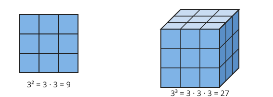

# Mocniny

**Co se naučíte**
- co je mocnina a jak ji spočítat,
- určit znaménko mocniny záporného čísla,
- používat pravidla pro počítání s mocninami,
- pracovat s nulovým a záporným exponentem,
- zapsat velká i malá čísla pomocí mocnin deseti.

**Co potřebujete znát**
- [násobení a dělení celých čísel](../01-cisla/vyklad.md#násobení-a-dělení-celých-čísel),
- [pořadí početních operací](../01-cisla/vyklad.md#pořadí-početních-operací),
- [násobení, dělení a převrácené zlomky](../02-zlomky/vyklad.md#násobení),
- [desetinná čísla](../02-zlomky/vyklad.md#zlomky-a-desetinná-čísla).

## Co je mocnina

Opakované sčítání stejného čísla zkracujeme násobením: $3 + 3 + 3 + 3 = 4 \cdot 3$. Podobně zkracujeme opakované násobení stejného čísla **mocninou**:

$$3 \cdot 3 \cdot 3 \cdot 3 = 3^4$$

- Číslo, které násobíme, je **základ** mocniny (zde 3).
- Malé číslo vpravo nahoře je **exponent** neboli mocnitel. Říká, kolikrát základ násobíme (zde 4krát).
- Výraz $3^4$ čteme „tři na čtvrtou“.

Obecně pro přirozené číslo $n$:

$$a^n = \underbrace{a \cdot a \cdot \ldots \cdot a}_{n\text{ činitelů}}$$

Platí $a^1 = a$. Mocnina na druhou se jmenuje **druhá mocnina** neboli čtverec, na třetí **třetí mocnina** neboli krychle. Názvy pocházejí z geometrie: čtverec o straně 3 má $3^2 = 9$ políček, krychle o hraně 3 má $3^3 = 27$ kostek.

**Příklad.** $2^5 = 2 \cdot 2 \cdot 2 \cdot 2 \cdot 2 = 32$, $\quad 10^3 = 10 \cdot 10 \cdot 10 = 1\,000$.

> ⚠️ Pozor: $3^4$ není $3 \cdot 4$. Exponent říká, kolikrát se základ násobí sám sebou: $3^4 = 81$, kdežto $3 \cdot 4 = 12$.

## Mocniny záporných čísel a zlomků

Je-li základ záporný, musí být v závorce. Znaménko určíte stejně jako u [násobení celých čísel](../01-cisla/vyklad.md#násobení-a-dělení-celých-čísel):

- **sudý** exponent → výsledek kladný: $(-2)^4 = (-2) \cdot (-2) \cdot (-2) \cdot (-2) = 16$,
- **lichý** exponent → výsledek záporný: $(-2)^3 = (-2) \cdot (-2) \cdot (-2) = -8$.

Mocnina zlomku umocní čitatele i jmenovatele:

$$\left(\frac{a}{b}\right)^n = \frac{a^n}{b^n} \qquad \text{např.} \quad \left(\frac{2}{3}\right)^2 = \frac{4}{9}$$

> ⚠️ Pozor: $(-3)^2$ a $-3^2$ jsou různé výrazy. V $(-3)^2 = 9$ se umocňuje celé záporné číslo. V $-3^2$ se umocňuje jen trojka a minus se přidá až potom: $-3^2 = -(3 \cdot 3) = -9$.

## Mocniny v pořadí operací

Mocniny mají přednost před násobením a dělením. Pořadí z [kapitoly Čísla](../01-cisla/vyklad.md#pořadí-početních-operací) se tedy rozšiřuje:

1. závorky,
2. **mocniny**,
3. násobení a dělení zleva doprava,
4. sčítání a odčítání zleva doprava.

**Příklad.** Spočítejte $2 \cdot 3^2$ a $(2 \cdot 3)^2$.

$$2 \cdot 3^2 = 2 \cdot 9 = 18 \qquad (2 \cdot 3)^2 = 6^2 = 36$$

## Pravidla pro počítání s mocninami

Všechna pravidla plynou z toho, že mocnina je opakované násobení. Stačí si činitele vypsat.

**Násobení mocnin se stejným základem:** exponenty se sčítají.

$$a^m \cdot a^n = a^{m+n} \qquad 2^3 \cdot 2^2 = (2 \cdot 2 \cdot 2) \cdot (2 \cdot 2) = 2^5$$

**Dělení mocnin se stejným základem:** exponenty se odečítají ($a \ne 0$).

$$a^m : a^n = a^{m-n} \qquad 5^6 : 5^4 = \frac{5 \cdot 5 \cdot 5 \cdot 5 \cdot 5 \cdot 5}{5 \cdot 5 \cdot 5 \cdot 5} = 5^2$$

**Mocnina mocniny:** exponenty se násobí.

$$(a^m)^n = a^{m \cdot n} \qquad (3^2)^3 = 3^2 \cdot 3^2 \cdot 3^2 = 3^6$$

**Mocnina součinu:** umocní se každý činitel.

$$(a \cdot b)^n = a^n \cdot b^n \qquad (2 \cdot 5)^3 = 2^3 \cdot 5^3 = 8 \cdot 125 = 1\,000$$

**Příklad.** Zjednodušte $\dfrac{x^5 \cdot x^3}{x^4}$ (pro $x \ne 0$).

$$\frac{x^5 \cdot x^3}{x^4} = \frac{x^8}{x^4} = x^4$$

> ⚠️ Pozor: Pro součet žádné takové pravidlo neplatí. $(a + b)^2 \ne a^2 + b^2$, například $(1 + 2)^2 = 9$, ale $1^2 + 2^2 = 5$. Stejně tak $2^3 + 2^2 \ne 2^5$: mocniny se sčítají jen tak, že je nejdřív spočítáte, $8 + 4 = 12$.

## Nultá a záporná mocnina

Zkusme pravidlo pro dělení na $5^3 : 5^3$. Číslo vydělené samo sebou je 1, a podle pravidla vyjde $5^{3-3} = 5^0$. Proto se definuje:

$$a^0 = 1 \qquad (a \ne 0)$$

Podobně $5^2 : 5^5 = \frac{5 \cdot 5}{5 \cdot 5 \cdot 5 \cdot 5 \cdot 5} = \frac{1}{5^3}$, a podle pravidla $5^{2-5} = 5^{-3}$. Proto:

$$a^{-n} = \frac{1}{a^n} \qquad (a \ne 0)$$

Záporný exponent tedy neznamená záporné číslo, ale [převrácenou hodnotu](../02-zlomky/vyklad.md#dělení).

**Příklad.** $2^{-3} = \frac{1}{2^3} = \frac{1}{8}$, $\quad 10^{-2} = \frac{1}{100} = 0{,}01$, $\quad \left(\frac{2}{3}\right)^{-2} = \left(\frac{3}{2}\right)^2 = \frac{9}{4}$.

Všechna pravidla z předchozí sekce platí i pro nulový a záporný exponent.

> ⚠️ Pozor: $2^{-3}$ není $-8$ ani $-6$. Je to kladné číslo $\frac{1}{8}$.

## Mocniny deseti a zápis čísel

S mocninami deseti se počítá snadno: exponent udává počet nul, u záporného exponentu počet desetinných míst.

| mocnina | hodnota | | mocnina | hodnota |
|---|---|---|---|---|
| $10^0$ | $1$ | | $10^{-1}$ | $0{,}1$ |
| $10^1$ | $10$ | | $10^{-2}$ | $0{,}01$ |
| $10^3$ | $1\,000$ | | $10^{-3}$ | $0{,}001$ |
| $10^6$ | $1\,000\,000$ | | $10^{-6}$ | $0{,}000\,001$ |

Velmi velká a velmi malá čísla zapisujeme ve **tvaru $a \cdot 10^n$**, kde $1 \le a < 10$ a $n$ je celé číslo. Říká se mu také vědecký zápis.

**Postup.** Desetinnou čárku posuňte tak, aby před ní zůstala jediná nenulová číslice. Počet míst, o který jste ji posunuli, je $n$. Kladný je, když jste posouvali doleva (číslo bylo velké), záporný, když doprava (číslo bylo malé).

**Příklad.**
- Vzdálenost Země od Slunce je asi $150\,000\,000\ \mathrm{km}$. Čárku posuneme o 8 míst doleva: $1{,}5 \cdot 10^8\ \mathrm{km}$.
- Tloušťka lidského vlasu je asi $0{,}000\,07\ \mathrm{m}$. Čárku posuneme o 5 míst doprava: $7 \cdot 10^{-5}\ \mathrm{m}$.

## Shrnutí

- $a^n = a \cdot a \cdot \ldots \cdot a$ ($n$ činitelů); $a$ je základ, $n$ exponent.
- Záporný základ se sudým exponentem dává kladný výsledek, s lichým záporný. $(-3)^2 = 9$, ale $-3^2 = -9$.
- Pořadí operací: závorky → mocniny → násobení a dělení → sčítání a odčítání.
- $a^m \cdot a^n = a^{m+n}$, $\ a^m : a^n = a^{m-n}$, $\ (a^m)^n = a^{m \cdot n}$, $\ (a \cdot b)^n = a^n \cdot b^n$.
- $a^0 = 1$, $\ a^{-n} = \frac{1}{a^n}$ (pro $a \ne 0$).
- Pro součet pravidla neplatí: $(a + b)^2 \ne a^2 + b^2$.
- Tvar $a \cdot 10^n$ s $1 \le a < 10$ slouží k zápisu velmi velkých a malých čísel.

---

Procvičte si látku: [Příklady ke kapitole Mocniny](priklady.md)
