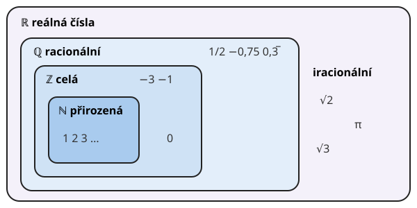

# Odmocniny

**Co se naučíte**
- co je druhá odmocnina a jak souvisí s druhou mocninou,
- používat pravidla pro násobení a dělení odmocnin a částečně odmocňovat,
- usměrňovat zlomky s odmocninou ve jmenovateli,
- počítat třetí a $n$-tou odmocninu a zapsat odmocninu jako mocninu,
- rozlišit racionální a iracionální čísla a popsat číselné obory.

**Co potřebujete znát**
- [mocniny a pravidla pro počítání s nimi](../03-mocniny/vyklad.md#pravidla-pro-počítání-s-mocninami),
- [mocniny záporných čísel](../03-mocniny/vyklad.md#mocniny-záporných-čísel-a-zlomků),
- [násobení, krácení a rozšiřování zlomků](../02-zlomky/vyklad.md#rozšiřování-a-krácení),
- [desetinná a periodická čísla](../02-zlomky/vyklad.md#zlomky-a-desetinná-čísla).

## Druhá odmocnina

Z kapitoly [Mocniny](../03-mocniny/vyklad.md) víte, že $5^2 = 25$. Odmocňování je opačná úloha: známe výsledek 25 a hledáme číslo, které po umocnění na druhou dá 25.

**Druhá odmocnina** z nezáporného čísla $a$ je **nezáporné** číslo, jehož druhá mocnina je $a$. Značí se $\sqrt{a}$:

$$\sqrt{a} = b \quad \text{právě když} \quad b^2 = a \ \text{a} \ b \ge 0$$

Číslo pod odmocninou je **odmocněnec**.

**Příklad.** $\sqrt{25} = 5$, protože $5^2 = 25$. Dále $\sqrt{0} = 0$, $\ \sqrt{1} = 1$, $\ \sqrt{144} = 12$.

Proč nezáporné? Také $(-5)^2 = 25$, ale odmocnina musí mít jediný výsledek. Proto se domluvilo, že $\sqrt{25}$ je kladné číslo 5.

Ze záporného čísla druhou odmocninu nespočítáte. Druhá mocnina žádného čísla není záporná (viz [sudý exponent](../03-mocniny/vyklad.md#mocniny-záporných-čísel-a-zlomků)), takže $\sqrt{-4}$ nemá mezi čísly, která znáte, smysl.

> ⚠️ Pozor: $\sqrt{25} = 5$, ne $\pm 5$. Pokud ale řešíte úlohu „které číslo umocněné na druhou dá 25?“, odpovědi jsou dvě: $5$ a $-5$. S tím se setkáte u rovnic.

Vyplatí se znát zpaměti druhé mocniny čísel 1 až 20:

| $n$ | 1 | 2 | 3 | 4 | 5 | 6 | 7 | 8 | 9 | 10 |
|---|---|---|---|---|---|---|---|---|---|---|
| $n^2$ | 1 | 4 | 9 | 16 | 25 | 36 | 49 | 64 | 81 | 100 |

| $n$ | 11 | 12 | 13 | 14 | 15 | 16 | 17 | 18 | 19 | 20 |
|---|---|---|---|---|---|---|---|---|---|---|
| $n^2$ | 121 | 144 | 169 | 196 | 225 | 256 | 289 | 324 | 361 | 400 |

Čísla v dolních řádcích jsou **druhé mocniny celých čísel**. Jejich odmocnina vyjde celá.

## Odmocnina a druhá mocnina

Odmocnina a druhá mocnina se navzájem ruší:

$$\left(\sqrt{a}\right)^2 = a \quad (a \ge 0), \qquad \sqrt{a^2} = |a|$$

Ve druhém vzorci je [absolutní hodnota](../01-cisla/vyklad.md#absolutní-hodnota). Výsledek odmocniny totiž nesmí být záporný: $\sqrt{(-3)^2} = \sqrt{9} = 3 = |-3|$.

**Příklad.** $\left(\sqrt{7}\right)^2 = 7$, $\quad \sqrt{6^2} = 6$, $\quad \sqrt{(-6)^2} = 6$.

## Odmocniny ze zlomků a desetinných čísel

Odmocnina zlomku se spočítá jako odmocnina čitatele dělená odmocninou jmenovatele:

$$\sqrt{\frac{9}{16}} = \frac{\sqrt{9}}{\sqrt{16}} = \frac{3}{4}$$

Desetinné číslo nejdřív převeďte na zlomek:

$$\sqrt{0{,}49} = \sqrt{\frac{49}{100}} = \frac{7}{10} = 0{,}7 \qquad \sqrt{0{,}04} = \sqrt{\frac{4}{100}} = 0{,}2$$

> ⚠️ Pozor: $\sqrt{0{,}9}$ není $0{,}3$. Platí $0{,}3^2 = 0{,}09$, takže $\sqrt{0{,}09} = 0{,}3$. Počet desetinných míst pod odmocninou musí být sudý, aby výsledek vyšel „hezky“.

## Pravidla pro počítání s odmocninami

Pro nezáporná čísla $a, b$ (u dělení $b > 0$) platí:

$$\sqrt{a \cdot b} = \sqrt{a} \cdot \sqrt{b} \qquad \sqrt{\frac{a}{b}} = \frac{\sqrt{a}}{\sqrt{b}}$$

Pravidla lze používat oběma směry.

**Příklad.**
- $\sqrt{4 \cdot 9} = \sqrt{4} \cdot \sqrt{9} = 2 \cdot 3 = 6$ (kontrola: $\sqrt{36} = 6$ ✓)
- $\sqrt{2} \cdot \sqrt{8} = \sqrt{16} = 4$
- $\dfrac{\sqrt{75}}{\sqrt{3}} = \sqrt{\dfrac{75}{3}} = \sqrt{25} = 5$

> ⚠️ Pozor: Pro součet a rozdíl žádné takové pravidlo neplatí. $\sqrt{9 + 16} = \sqrt{25} = 5$, ale $\sqrt{9} + \sqrt{16} = 3 + 4 = 7$. Obecně $\sqrt{a + b} \ne \sqrt{a} + \sqrt{b}$.

Sčítat a odčítat lze jen **stejné odmocniny**, podobně jako stejné předměty: $3\sqrt{2} + 5\sqrt{2} = 8\sqrt{2}$ (tři odmocniny ze dvou a pět odmocnin ze dvou je osm odmocnin ze dvou). Výraz $\sqrt{2} + \sqrt{3}$ už zjednodušit nelze.

Zápis $3\sqrt{2}$ znamená $3 \cdot \sqrt{2}$, znak násobení se před odmocninou vynechává.

## Částečné odmocnění

Když odmocněnec není druhou mocninou celého čísla, často ho můžete rozložit na součin, ve kterém jeden činitel druhou mocninou je. Ten pak odmocníte a zbytek nechte pod odmocninou:

$$\sqrt{50} = \sqrt{25 \cdot 2} = \sqrt{25} \cdot \sqrt{2} = 5\sqrt{2}$$

**Postup.** Hledejte co největší dělitele odmocněnce mezi čísly $4, 9, 16, 25, 36, 49, \dots$

**Příklad.** Zjednodušte $\sqrt{12} + \sqrt{27}$.

$$\sqrt{12} + \sqrt{27} = \sqrt{4 \cdot 3} + \sqrt{9 \cdot 3} = 2\sqrt{3} + 3\sqrt{3} = 5\sqrt{3}$$

Po částečném odmocnění se z různých odmocnin staly stejné, a tak šly sečíst.

## Usměrňování zlomků

Zlomek s odmocninou ve jmenovateli, např. $\frac{1}{\sqrt{2}}$, se obvykle upravuje tak, aby ve jmenovateli odmocnina nebyla. Tato úprava se jmenuje **usměrnění** zlomku. Zlomek [rozšíříte](../02-zlomky/vyklad.md#rozšiřování-a-krácení) odmocninou, která je ve jmenovateli. Hodnota zlomku se nezmění, protože $\frac{\sqrt{2}}{\sqrt{2}} = 1$:

$$\frac{1}{\sqrt{2}} = \frac{1 \cdot \sqrt{2}}{\sqrt{2} \cdot \sqrt{2}} = \frac{\sqrt{2}}{2}$$

**Příklad.** Usměrněte $\dfrac{6}{\sqrt{3}}$.

$$\frac{6}{\sqrt{3}} = \frac{6\sqrt{3}}{\sqrt{3} \cdot \sqrt{3}} = \frac{6\sqrt{3}}{3} = 2\sqrt{3}$$

## Třetí a n-tá odmocnina

**Třetí odmocnina** z čísla $a$ je číslo, jehož třetí mocnina je $a$. Značí se $\sqrt[3]{a}$:

$$\sqrt[3]{8} = 2, \ \text{protože} \ 2^3 = 8 \qquad \sqrt[3]{-27} = -3, \ \text{protože} \ (-3)^3 = -27$$

Na rozdíl od druhé odmocniny lze třetí odmocninu spočítat i ze záporného čísla. Třetí mocnina záporného čísla je totiž záporná ([lichý exponent](../03-mocniny/vyklad.md#mocniny-záporných-čísel-a-zlomků)).

Obecně **$n$-tá odmocnina** $\sqrt[n]{a}$ je číslo, jehož $n$-tá mocnina je $a$. Malé číslo $n$ je **odmocnitel**. U druhé odmocniny se dvojka nepíše: $\sqrt{a} = \sqrt[2]{a}$.

- Je-li $n$ **sudé**, musí být $a \ge 0$ a výsledek je nezáporný: $\sqrt[4]{16} = 2$.
- Je-li $n$ **liché**, může být $a$ jakékoli: $\sqrt[5]{-32} = -2$.

Pravidla pro součin a podíl platí stejně: $\sqrt[n]{a \cdot b} = \sqrt[n]{a} \cdot \sqrt[n]{b}$, $\ \sqrt[n]{\frac{a}{b}} = \frac{\sqrt[n]{a}}{\sqrt[n]{b}}$.

## Odmocnina jako mocnina

Platí-li pravidla pro mocniny ze [3. kapitoly](../03-mocniny/vyklad.md#pravidla-pro-počítání-s-mocninami) i pro zlomkový exponent, musí být $\left(a^{\frac{1}{2}}\right)^2 = a^{\frac{1}{2} \cdot 2} = a^1 = a$. Číslo $a^{\frac{1}{2}}$ se tedy chová přesně jako $\sqrt{a}$. Proto se pro $a \ge 0$ definuje:

$$a^{\frac{1}{n}} = \sqrt[n]{a} \qquad a^{\frac{m}{n}} = \sqrt[n]{a^m} = \left(\sqrt[n]{a}\right)^m$$

**Příklad.** $9^{\frac{1}{2}} = \sqrt{9} = 3$, $\quad 8^{\frac{2}{3}} = \left(\sqrt[3]{8}\right)^2 = 2^2 = 4$, $\quad 16^{-\frac{1}{2}} = \frac{1}{\sqrt{16}} = \frac{1}{4}$.

Díky tomu můžete výrazy s odmocninami upravovat pomocí pravidel pro mocniny:

$$\sqrt{a} \cdot \sqrt[3]{a} = a^{\frac{1}{2}} \cdot a^{\frac{1}{3}} = a^{\frac{1}{2} + \frac{1}{3}} = a^{\frac{5}{6}} = \sqrt[6]{a^5}$$

## Iracionální čísla a číselné obory

Číslo, které lze zapsat jako zlomek $\frac{p}{q}$ s celými $p, q$ a $q \ne 0$, je **racionální číslo**. Patří sem celá čísla, zlomky, konečná i [periodická](../02-zlomky/vyklad.md#zlomky-a-desetinná-čísla) desetinná čísla. Množina racionálních čísel se značí $\mathbb{Q}$.

Ne každé číslo je racionální. Například $\sqrt{2}$, tedy délka úhlopříčky čtverce o straně 1, se zlomkem zapsat nedá. Jeho desetinný rozvoj je nekonečný a nikdy se neopakuje:

$$\sqrt{2} = 1{,}414\,213\,562\ldots$$

Taková čísla se nazývají **iracionální čísla**. Patří k nim odmocniny přirozených čísel, která nejsou druhými mocninami ($\sqrt{3}, \sqrt{5}, \sqrt{8}, \dots$), nebo číslo $\pi = 3{,}141\,59\ldots$

Racionální a iracionální čísla dohromady tvoří **reálná čísla** $\mathbb{R}$. Odpovídají všem bodům [číselné osy](../01-cisla/vyklad.md#číselná-osa). Číselné obory jsou do sebe vnořené:

$$\mathbb{N} \subset \mathbb{Z} \subset \mathbb{Q} \subset \mathbb{R}$$

Znak $\subset$ čtěte „je částí“: každé přirozené číslo je celé, každé celé je racionální a každé racionální je reálné.

> ⚠️ Pozor: Kalkulačka ukáže $\sqrt{2} \approx 1{,}414\,213\,6$. Je to jen přibližná hodnota (znak $\approx$ čtěte „přibližně“). Kde to jde, počítejte s přesným tvarem $\sqrt{2}$ a zaokrouhlujte až na konci.

## Shrnutí

- $\sqrt{a} = b$, právě když $b^2 = a$ a $b \ge 0$; ze záporného čísla druhá odmocnina neexistuje.
- $\left(\sqrt{a}\right)^2 = a$, $\ \sqrt{a^2} = |a|$.
- $\sqrt{a \cdot b} = \sqrt{a} \cdot \sqrt{b}$, $\ \sqrt{\frac{a}{b}} = \frac{\sqrt{a}}{\sqrt{b}}$; pro součet pravidlo neplatí.
- Částečné odmocnění: $\sqrt{50} = \sqrt{25 \cdot 2} = 5\sqrt{2}$.
- Usměrnění: zlomek rozšíříte odmocninou ze jmenovatele, $\frac{1}{\sqrt{2}} = \frac{\sqrt{2}}{2}$.
- $n$-tá odmocnina se sudým $n$ jen z nezáporných čísel, s lichým $n$ z jakýchkoli.
- $a^{\frac{1}{n}} = \sqrt[n]{a}$, $\ a^{\frac{m}{n}} = \sqrt[n]{a^m}$.
- $\mathbb{N} \subset \mathbb{Z} \subset \mathbb{Q} \subset \mathbb{R}$; iracionální čísla (např. $\sqrt{2}$, $\pi$) jsou reálná, ale ne racionální.

---

Procvičte si látku: [Příklady ke kapitole Odmocniny](priklady.md)
